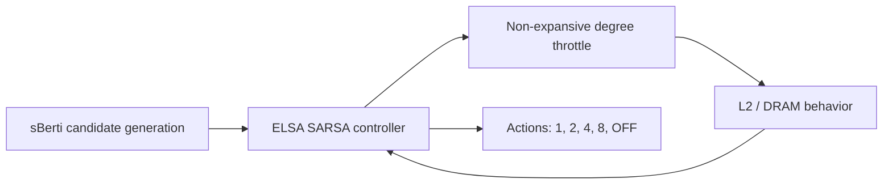

# ELSA

**Action-Space Completeness for SARSA Prefetch Throttling in Resource-Constrained Processors**

**Tushar Dhananjay Kale · Soma N. Ghosh**  
COEP Technological University

ELSA studies a simple systems question with a surprisingly strong consequence:

> **What happens when a learning controller is not allowed to choose the action the system actually needs?**

In the sBerti prefetching stack, the legacy SARSA controller can select only positive prefetch caps `{1, 2, 4, 8}`. ELSA audits that feasible action set, adds a local controlled-OFF action, and evaluates the completed action vocabulary `{0, 1, 2, 4, 8}` without replacing the underlying address-generation algorithms.

The central result is deliberately not framed as a universal benchmark win. The broad 24-workload study shows only a small aggregate NEW5-over-OLD4 gain, while prospectively frozen suppression-sensitive regions show a much larger effect. The artifact therefore preserves both the positive and negative evidence needed to test the structural claim.

---

## Research at a glance

| Item | Final frozen artifact |
|---|---|
| Controller state | `s_t = 2 b_acc + I[d_t > 2]` |
| Reward | `100(u_t-u_{t-1}) - 5 d_t I[b_t >= 3]` |
| Learning | SARSA, `alpha=0.5`, `gamma=0.6`, `epsilon=0` |
| Scientific epoch | 1024 L2 accesses |
| OLD4 action set | `{1, 2, 4, 8}` |
| NEW5 action set | `{0, 1, 2, 4, 8}` |
| Physical action map | `[1, 2, 4, 8, 0]` |
| Canonical campaign | **Final617: 617/617 completed executions** |
| Final RTL | **H7 static-decode realization** |

### Key evidence

- **NEW5 vs uncapped A1:** **+4.0955%** geometric-mean IPC, 20/1/3 win/tie/loss.
- **NEW5 vs OLD4:** **+0.3054%** geometric-mean IPC, median **-0.0026%**, 7/4/13; exact sign-test **p = 0.263**.
- **NEW5 vs strongest single global fixed cap F1:** **+0.2502%** on the frozen common surface.
- **Prospective MCF regions:** **+7.2278%**, 5/0/0.
- **Prospective LBM regions:** **+0.0108%**, a near-null boundary.
- **DRAM transactions vs A1:** **-9.6834%**.
- **Issued prefetches vs A1:** **-50.07%** while useful prefetches increase **+15.46%**.
- **Final H7 routed frequency:** **33.88 MHz**, **11.723×** the original NEW5 routed frequency.
- The preregistered **100 MHz target is not met**; this limitation is retained in the artifact.

These numbers are not pooled as an inferential `n=617`. Final617 is an execution ledger containing several distinct, frozen evaluation blocks.

---

## Why action-space completeness matters

A learning algorithm can optimize only over actions it can represent. If the locally optimal operating point is controlled OFF but OFF is absent from the feasible set, better learning cannot recover that action.

ELSA turns that observation into an auditable architecture/evidence chain:



Controlled OFF suppresses only the ELSA-controlled SmartStride path. It is **not** the same as a global no-prefetch configuration.

---

## Repository map

```text
src/
  inc/
    sberti.h                  # final repaired NEW5 controller interface
    cache.h                   # final cache integration interface
  prefetcher/
    sberti.cc                 # final repaired NEW5 implementation
    l2c_prefetcher.cc         # final repaired L2 integration
    llc_prefetcher.cc         # final repaired LLC integration
  cache.cc                    # final repaired cache callback/timing path

hardware/
  rtl/elsa_controller.sv      # final H7 static-decode RTL
  README.md                   # hardware result and limitation map

results/
  final617/
    ELSA_FINAL617_raw_ipc.csv # canonical compact 617-execution IPC ledger
    FINAL_617_JOB_MATRIX_PUBLIC.tsv  # frozen campaign matrix
    COMMON_ARGS.json          # frozen common run arguments
    CLOSURE_PUBLIC.txt               # campaign closure record
    CAMPAIGN_COMPLETE.txt     # completion record
  hardware/final_h7/          # final H7 compact evidence
  README.md                   # canonical vs historical result directories

provenance/
  final617/                   # traces, binary, status/log hashes, manifest
  hardware/                   # final hardware manifest
  README.md                   # provenance guide

scripts/
  verify_artifact.sh          # lightweight integrity/contract checker

docs/
  REPRODUCIBILITY.md
  EXPERIMENTAL_CONTRACT.md
  REPRODUCIBILITY_STATUS.md

ARTIFACT.md                   # paper-to-artifact map
PROVENANCE.md                 # final artifact lineage
CITATION.cff                  # citation metadata
```

---

## Reproducibility

The repository publishes the compact frozen evidence needed to audit the current paper without redistributing benchmark traces that may have licensing restrictions.

Start with:

```bash
bash scripts/verify_artifact.sh
```

The checker verifies the final repaired NEW5 source hashes, the five-action contract, the canonical 617-row IPC ledger, and the final H7 result markers. It does **not** launch ChampSim or rerun the campaign.

For the full experimental contract, trace policy, and campaign layout, see [`docs/REPRODUCIBILITY.md`](docs/REPRODUCIBILITY.md) and [`docs/EXPERIMENTAL_CONTRACT.md`](docs/EXPERIMENTAL_CONTRACT.md).

---

## Evidence discipline

The current paper uses **Final617** as the canonical numerical source. Earlier result folders are retained only for research lineage and should not be mixed with Final617 claims. In particular:

- MASTER14 establishes the broad adaptive-throttling result and the selective NEW5-vs-OLD4 effect.
- E32/128 tests epoch sensitivity.
- Prospective72 evaluates cross-generation, prospectively frozen MCF/LBM regions.
- T5_112 extends the family test and does **not** establish the robust-optimum certificate.
- HELDOUT25 is a legacy A2/F1 transfer study and is not a NEW5 evaluation.

Negative and null outcomes are intentionally retained. They are part of the claim boundary, not discarded runs.

---

## Hardware realization

The final artifact uses the **H7 static-decode** RTL. The frozen hardware evidence reports:

- 0/256 replay mismatches,
- action index 4 → degree 0 exercised 194 times,
- maximum update latency of 111 cycles,
- routed frequency of **33.88 MHz**,
- 20,712 combinational cells, 8,623 flip-flops, 11 multipliers, 0 BRAM,
- and a **failed 100 MHz preregistered timing target**.

The FPGA resource/frequency data are specific to the frozen flow and are not ASIC area, timing, or energy measurements.

See [`hardware/README.md`](hardware/README.md).

---

## Paper and citation

**Paper:** *ELSA: Action-Space Completeness for SARSA Prefetch Throttling in Resource-Constrained Processors*.

A public preprint/arXiv link can be added here once released. Citation metadata are already provided in [`CITATION.cff`](CITATION.cff).

---

## Upstream and contribution boundary

Berti and sBerti are prior work. ELSA does not replace their address-generation algorithms; it studies and realizes a lightweight runtime action-space/control layer around the SmartStride path, together with the accompanying theory, frozen evaluation, and hardware semantics.

See [`provenance/UPSTREAM.md`](provenance/UPSTREAM.md) and [`PROVENANCE.md`](PROVENANCE.md) for the lineage and artifact boundary.

---

## License

See [`LICENSE`](LICENSE) and [`NOTICE.md`](NOTICE.md). Upstream components retain their original licensing and attribution requirements.
